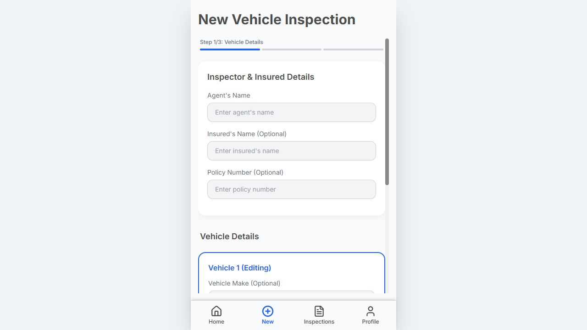

# AutoInspect

Aplicación web para registrar inspecciones vehiculares desde un teléfono o computador. El flujo guía al inspector por los datos del vehículo, las fotografías y un resumen que puede exportarse a PDF.



## Qué se puede probar

- Crear una inspección con uno o varios vehículos.
- Adjuntar fotografías por categoría y revisar el resumen.
- Guardar inspecciones en el navegador mediante IndexedDB y volver a abrirlas.
- Generar un reporte PDF.

La aplicación es una PWA y su interfaz principal funciona sin conexión después de instalarse. Los datos de inspección se guardan en el navegador usado para la prueba; conviene emplear datos ficticios al evaluarla.

## Ejecutar localmente

Requisitos: Node.js 20 o posterior y npm.

```bash
git clone https://github.com/Naivelk/AutoInspect-PDF-Reports.git
cd AutoInspect-PDF-Reports
npm ci
npm run dev
```

Abre la dirección local que muestre Vite y selecciona **New Inspection**. Puedes completar el formulario con datos de prueba, añadir fotos y generar el PDF. Para comprobar que la inspección persiste, vuelve al inicio y abre **View Saved**.

Para generar la versión de producción:

```bash
npm run build
npm run preview
```

## Tecnologías y estructura

React, TypeScript, Vite, Tailwind CSS, IndexedDB (`idb`) y jsPDF. La interfaz está en `screens/` y `components/`; el almacenamiento y la generación de reportes están en `services/`.

## Alcance

Este repositorio muestra el código y una captura real del formulario. No se publican aquí datos de inspecciones reales ni se afirma una reducción de tiempo sin una medición verificable.

## Autor

Kevin Santiago Quimbaya Andrade · [Portafolio](https://kevin-quimbaya-portafolio.naivelk.chatgpt.site/)
